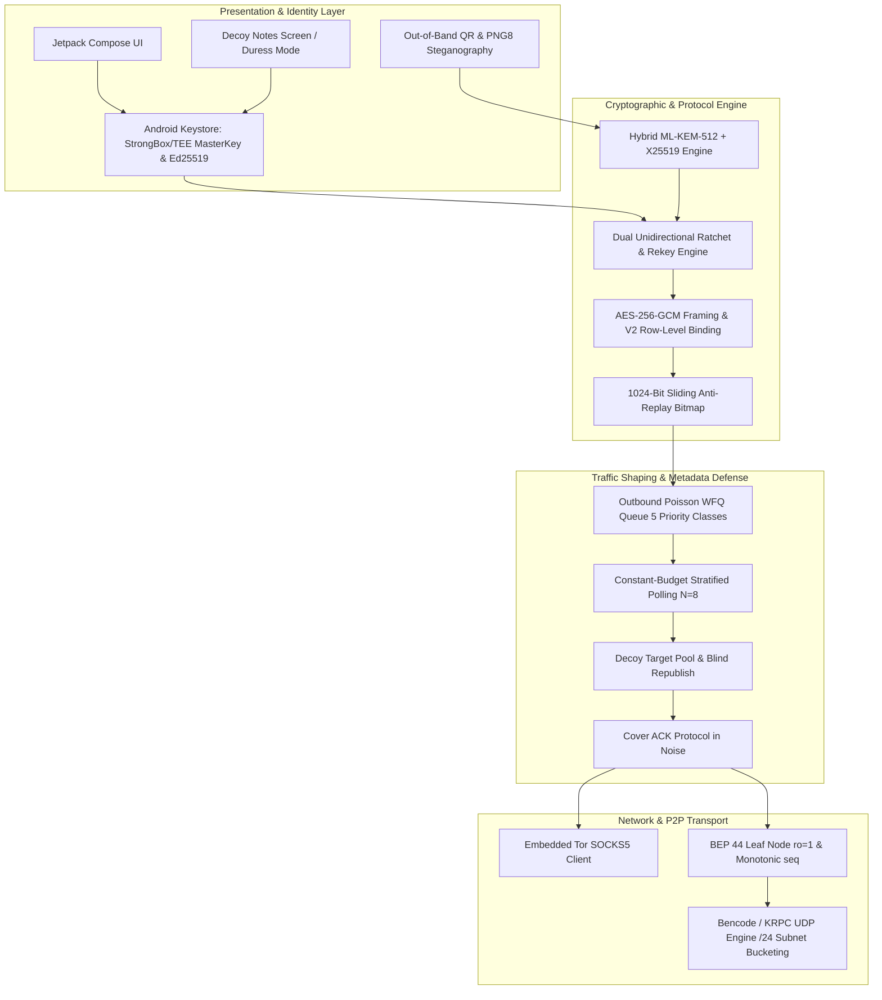
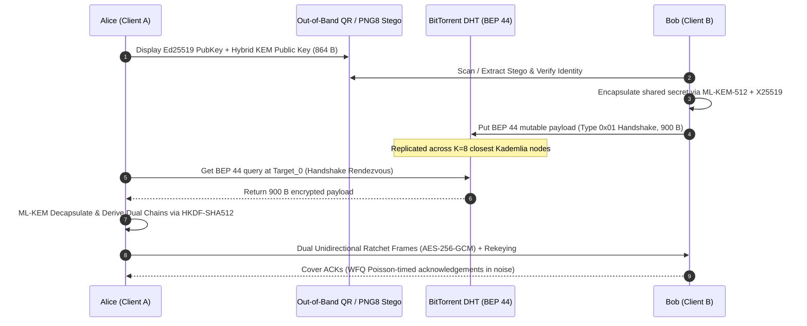

# PQChat.DHT

<p align="center">
  <strong>Decentralized, Post-Quantum P2P Covert Messaging over BitTorrent Mainline DHT</strong><br>
  <em>Statistical Traffic Masking • Formal ProVerif Verification • Zero Infrastructure</em>
</p>

<p align="center">
  <a href="https://github.com/mppjuro/PQChat.DHT/actions/workflows/android.yml">
    
  </a>
  <a href="https://github.com/mppjuro/PQChat.DHT/actions/workflows/nightly.yml">
    
  </a>
  <a href="LICENSE">
    
  </a>
  <a href="https://csrc.nist.gov/pubs/fips/203/final">
    
  </a>
  <a href="docs/formal/">
    
  </a>
  <a href="https://github.com/mppjuro/PQChat.DHT/actions/workflows/formal_verification.yml">
    
  </a>
  <a href="CHANGELOG.md">
    
  </a>
  <a href="https://github.com/mppjuro/PQChat.DHT/releases/tag/nightly">
    
  </a>
</p>

---

## 🔬 Overview & Academic Context

Traditional secure messaging platforms rely on centralized directory and signaling servers, leaking rich transactional metadata (timing, communication graphs, peer IP addresses) and remaining susceptible to future decryption by quantum adversaries through **Harvest Now, Decrypt Later (HNDL)** attacks.

**PQChat.DHT** is an experimental, serverless peer-to-peer covert messaging system developed for Android as part of a Master's Thesis in Computer Science. It achieves end-to-end privacy and metadata resistance by combining:
1. **Post-Quantum Cryptography (PQC)**: Key exchange based on **ML-KEM-512** (NIST FIPS 203) with double ratcheting for Forward Secrecy and Post-Compromise Security.
2. **Serverless P2P Storage**: Storage and discovery via BitTorrent Mainline DHT using signed mutable items (**BEP 44** / Kademlia).
3. **Statistical Traffic Masking**: Shaping network traffic using Poisson-distributed cover traffic, constant-budget stratified polling, and decoy queries to defeat side-channel and timing correlation attacks.
4. **Network Obfuscation**: Optional embedded SOCKS5 routing through the Tor network.
5. **Formal Verification**: Verified protocol invariants using **ProVerif 2.05+** symbolic analysis across 8 models and 32 security lemmas.

> [!WARNING]
> **Alpha Status**: This project is an academic research prototype. While the core protocol has been formally verified with ProVerif, the Android implementation has not undergone independent professional cryptographic and application security audits. Do not rely on it for operational life-critical communications.

---

## 🏛️ System Architecture



---

## ✨ Key Features

### 1. Post-Quantum End-to-End Cryptography

* **Hybrid ML-KEM-512 + X25519 (FIPS 203 + RFC 7748)**: High-performance lattice-based key encapsulation mechanism paired with X25519 protecting against both classical and quantum adversaries (`MLKemEngine.kt`, `PqcEngine.kt`).
* **Hardware-Backed Identity & Master Key**: Ed25519 signing keys and AES-256-GCM master keys anchored in the Android hardware-backed Keystore with StrongBox HSM / Titan M prioritization (`KeystoreCrypto.kt`, `Ed25519Engine.kt`).
* **Dual Unidirectional Ratchet Chains**: Independent monotonically incremented chains for outbound and inbound tracks preventing state race conditions (`RatchetChain.kt`, `RekeyCoordinator.kt`).
* **Database Row/Column Binding (`MAGIC_ROW_BOUND_V2` = `0x52`)**: SQLite fields encrypted with AES-256-GCM with AAD bound to `table + "+" + id + "+" + column`, preventing row and column swap attacks.
* **Duress PIN & Hardware Wipe**: Entering an emergency PIN irrevocably purges the Keystore master key from hardware, rendering database ciphertexts permanent noise ($P < 2^{-256}$), and seamlessly displays `DecoyNotesScreen` for plausible deniability.

### 2. Decentralized BEP 44 DHT Transport

* **Zero Infrastructure**: Operates on the public BitTorrent Mainline DHT network with no central servers, relays, or STUN/TURN infrastructure.
* **Lightweight Client-Only Leaf Node (`ro=1`)**: Never routes third-party traffic or stores third-party blobs in RAM; strictly enforces read-only flag per BEP 43 (`DhtLeafNode.kt`, `DhtClient.kt`).
* **Monotonic Sequence Enforcement & Anti-Replay**: BEP 44 mutable sequence numbers strictly advance (`seq`), backed by 1024-bit sliding anti-replay bitmaps (`SlidingWindowBitmap.kt`).
* **Rigid 900 B Records & Safe Tombstones**: Every record is exactly 900 bytes (904 B in Bencode). Consumed message slots are overwritten with 900 B of pure CSPRNG noise (`BinaryFrameCodec.createTombstonePayload`), eliminating delivery acknowledgement timing leakage.

### 3. Traffic Analysis Countermeasures

* **Constant-Budget Stratified Polling ($N_{\text{poll}} = 8$)**: Every polling cycle queries exactly 8 DHT targets, using Weighted Fair Stratified Sampling when active tracks exceed 8, and padding with `DecoyTargetPool` decoys when fewer, preventing traffic volume side channels.
* **Weighted Fair Queuing (WFQ) Outbound Poisson Traffic**: 5 priority classes (`DIRECT_TEXT`, `DIRECT_ACK`, `GROUP_TEXT`, `IMAGE_CHUNK`, `COVER_DUMMY`) scheduled over a deterministic 8-slot frame `[DIRECT, GROUP, DIRECT, GROUP, DIRECT, IMAGE, DIRECT, COVER]` via `OutboundPoissonQueue.kt`.
* **Cover ACKs Concealed in Noise**: Acknowledgments transmitted at symmetrical $\text{Target}_{ACK}$ concealed within 900 B noise records (`CoverAckProtocol.kt`).
* **Adaptive Polling Lifecycle**: Centralized state coordinator (`PollingLifecycleCoordinator.kt`) dynamically switches between 10s, 1m, 5m, and 15m intervals across Android Doze and Cached App Freezer states.

### 4. Anonymity, Media & Steganography

* **Handshake Steganography (`Png8Compressor.kt`)**: In-flight steganographic embedding of QR handshake material into 8-bit indexed PNG palettes (`STEG_MAGIC = "PQST"`, CRC32).
* **Embedded Tor Routing**: Built-in Tor daemon and SOCKS5 proxy factory (`EmbeddedTorManager.kt`, `TorSocketFactory.kt`).
* **Chunked Binary Transfers**: Reliable binary file slicing and transfer protocol for compressed images (`ChunkingEngine.kt`, Type `0x05`).

### 5. Micro-Payloads & Ephemeral Communications

* **Message Reactions (Type `0x07`)**: Compact emoji reaction frames bound to target message epoch and sequence number (`TYPE_REACTION`).
* **Location Pins & Safety Status (Type `0x08`)**: Latitude, longitude, altitude, accuracy, and emergency status notes (`TYPE_LOCATION_PIN`).
* **Ephemeral Self-Destructing Messages (`MAGIC_EPHEMERAL`)**: Overhead-free self-destructing message header (`0x5051435F4550484DL`) with configurable TTL in seconds.

### 6. Decentralized Post-Quantum Group Messaging (Sender Keys over BEP 44)

* **Metadata-Free Group Addressing (`deriveGroupRecipientSlot`)**: For each broadcast, the sender derives unique recipient slots:
  $$\text{Target}_{slot} = \text{RatchetChain.deriveGroupRecipientSlot}(ChainKey, Counter, GroupID, RecipientMemberID)$$
  eliminating Group Follower Correlation and preventing eavesdroppers from discovering group membership.
* **AAD Context Binding**: Group payloads bound to $\text{AAD} = \text{Target} \parallel GroupID \parallel SenderMemberID$.
* **Forward Secrecy & Post-Compromise Security (PCS)**: Automatic epoch rotation every 50 messages, and instant forced rekeying upon member leave (`GROUP_SUBTYPE_LEAVE`) isolating departed members from all future frames.

---

## 🔒 Protocol Flow



Detailed message layouts, frame headers, and serialization rules are specified in [`docs/PROTOCOL.md`](docs/PROTOCOL.md). The security assumptions and adversary capabilities are analyzed in [`docs/threat_model.md`](docs/threat_model.md).

---

## 📐 Formal Verification (ProVerif)

The core cryptographic protocol is formally verified using **[ProVerif](https://bblanche.gitlabpages.inria.fr/proverif/)** symbolic protocol analyzer. All verification scripts and proof models are unified in the [`docs/formal/`](docs/formal/) directory.

The formal suite encompasses dual-defense **Hybrid KEM (ML-KEM-512 + X25519)**, **Anti-Grinding SAS**, **Dual Unidirectional Chains**, **900-byte CSPRNG safe tombstones**, **Decentralized Post-Quantum Group Messaging**, **Micro-Payload AAD Binding**, and **Duress Wipe Irreversibility** (32 lemmas verified across 8 models):

| Property | Model File | Verified Security Guarantee | Status |
| --- | --- | --- | --- |
| **Unified Protocol** | `pqchat_protocol.pv` | MasterKey, dual chain keys, AAD-bound payloads, SAS binding, micro-payloads (0x07, 0x08) | `RESULT: True` (12/12) |
| **Secrecy & Confirmation** | `pqchat_secrecy.pv` | Payload secrecy & injective mutual authentication under Hybrid KEM | `RESULT: True` (5/5) |
| **Forward Secrecy** | `pqchat_forward_secrecy.pv` | Past messages protected upon ratchet state compromise in RAM | `RESULT: True` (2/2) |
| **Post-Compromise (PCS)** | `pqchat_post_compromise.pv` | Session recovery & self-healing after breach via Hybrid KEM rekey | `RESULT: True` (2/2) |
| **Replay Protection** | `pqchat_replay.pv` | Injective packet correspondences & safe tombstone slot invalidation | `RESULT: True` (2/2) |
| **Unlinkability & Tombstones** | `pqchat_unlinkability.pv` | Target unlinkability (diff-equivalence) & 900B tombstone indistinguishability | `RESULT: True` (1/1) |
| **Group Protocol & PCS/FS** | `pqchat_group_protocol.pv` | Group sender keys distribution, AAD binding, and group PCS/FS on member leave | `RESULT: True` (4/4) |
| **Duress Wipe & Row Binding** | `pqchat_duress_wipe.pv` | Irreversibility of master key erasure, decoy transition, and SQLite row/column swap resistance | `RESULT: True` (4/4) |

To reproduce the formal verification suite locally:

```bash
bash docs/formal/run_verification.sh
```

---

## 🧪 Testing & Fuzzing

The repository maintains an extensive test suite exceeding standard unit testing:

* **Known Answer Tests (KAT)**: Validates ML-KEM-512 against official NIST test vectors (`MlKemKatAndUniquenessTest.kt`).
* **Security & Parser Fuzzing**: Continuous fuzzing powered by **Jazzer** targeting KRPC message parsing and Bencode decoders (`JazzerFuzzTest.kt`, `BencodeSecurityTest.kt`).
* **Traffic Threat Statistical Tests**: Monte-Carlo simulations testing statistical indistinguishability of cover traffic (`TrafficThreatModelStatisticalTest.kt`).
* **DHT Integration Tests**: Real-world loopback and remote DHT persistence verification (`RealBep44RemoteIntegrationTest.kt`, `tools/dht_harness/`).
* **Language Unification Linter**: Strict CI verification ensuring 100% English codebase with 0 unauthorized characters (`scripts/check_language_unification.py`).

Run unit and integration tests:

```bash
./gradlew testDebugUnitTest
```

---

## 📊 Empirical Benchmarks & Simulation

The repo includes reproducible Python test harnesses and threat simulators to evaluate battery, bandwidth, and latency trade-offs:

* **Loopback DHT Measurement**: Real packet retention and latency charts generated under [`docs/dht_retention_report.md`](docs/dht_retention_report.md).
* **Threat Simulator**: Simulates deanonymization probability against adversary nodes under varying cover-traffic rates (`tools/threat_sim/threat_simulator.py`).
* **150-Node Isolated Kademlia Testbed**: Cluster testing environment for measuring real-traffic correlation resistance (`tools/testbed/testbed_runner.py`).

```bash
# Run the simulation suite
cd tools/threat_sim
pip install -r requirements.txt
python threat_simulator.py
```

---

## 📂 Repository Layout

```text
PQChat.DHT/
├── .github/workflows/       # CI: android.yml, nightly.yml, formal_verification.yml
├── app/
│   └── src/
│       ├── main/java/org/pqchat/dht/
│       │   ├── crypto/      # ML-KEM, Ed25519, AES-GCM, HKDF, Keystore wrappers
│       │   ├── data/        # Room Database, Repositories, Preferences
│       │   ├── dht/         # BEP 44 client, Kademlia leaf node, KRPC, Bencode
│       │   ├── media/       # PNG-8 quantizer, compressor & steganography
│       │   ├── network/tor/ # Embedded Tor daemon & SOCKS5 socket factory
│       │   ├── protocol/    # Handshake, Ratchet chains, Chunking, Cover ACKs
│       │   ├── research/    # Research telemetry, Firebase sync, TTL sampling
│       │   ├── service/     # Lifecycle coordinator, Alarm receivers, WorkManager
│       │   ├── traffic/     # Poisson generator, Outbound WFQ, Decoy pools
│       │   └── ui/          # Compose screens (Chat, Contacts, DecoyNotes), ViewModels
│       └── test/java/       # KAT tests, Jazzer fuzzing, Concurrency & Property tests
├── docs/                    # Technical documentation, PROTOCOL.md, Threat Model
│   ├── android_lifecycle_background_execution.md # Lifecycle state machine & Doze
│   ├── formal/              # ProVerif formal verification models (.pv) & scripts
│   └── dht_retention_report.md # Experimental retention metrics & analysis
├── scripts/
│   └── check_language_unification.py # 100% English unified language checker
└── tools/
    ├── dht_harness/         # P2P loopback benchmarking scripts & raw CSV metrics
    ├── testbed/             # 150-node isolated Kademlia cluster testbed runner
    ├── threat_sim/          # Python Monte-Carlo anonymity vs. battery simulator
    └── e2e_emulator_orchestrator.py # Multi-device Android emulator orchestrator
```

---

## 🚀 Building & Getting Started

### Prerequisites

* **JDK 17** or **JDK 21**
* **Android SDK** (minSdk 26, targetSdk 34)
* **Android Studio Ladybug** (2024.2+) or CLI Gradle

### Build Instructions

```bash
# Clone the repository
git clone https://github.com/mppjuro/PQChat.DHT.git
cd PQChat.DHT

# Verify language unification
python scripts/check_language_unification.py

# Verify formal ProVerif models (32 lemmas)
bash docs/formal/run_verification.sh

# Run unit tests and crypto KATs
./gradlew testDebugUnitTest

# Build the debug APK
./gradlew assembleDebug
```

The compiled APK will be available in `app/build/outputs/apk/debug/app-debug.apk`.

---

## 📜 Changelog & Releases

- **Changelog History:** A comprehensive list of introduced features, bug fixes, and changes is documented in [`CHANGELOG.md`](CHANGELOG.md).
- **Official Releases:** Visit [Releases](https://github.com/mppjuro/PQChat.DHT/releases) to download stable APK installation packages.
- **Nightly Builds:** The latest developer APK is built automatically every night and available under [Nightly Release](https://github.com/mppjuro/PQChat.DHT/releases/tag/nightly).

---

## 📄 License & Attribution

This project is licensed under the **GNU General Public License v3.0** (GPLv3) — see the [`LICENSE`](LICENSE) file for details.

### Academic Citation

If you utilize this work or its formal models in academic research, please cite:

```bibtex
@mastersthesis{pqchat_dht_2026,
  author       = {Miłosz Piórkowski},
  title        = {Decentralized P2P Mobile Messenger Resistant to Traffic Analysis Based on DHT and Post-Quantum Cryptography},
  school       = {Nicolaus Copernicus University in Toruń (UMK)},
  year         = {2026},
  note         = {GitHub: https://github.com/mppjuro/PQChat.DHT}
}
```
