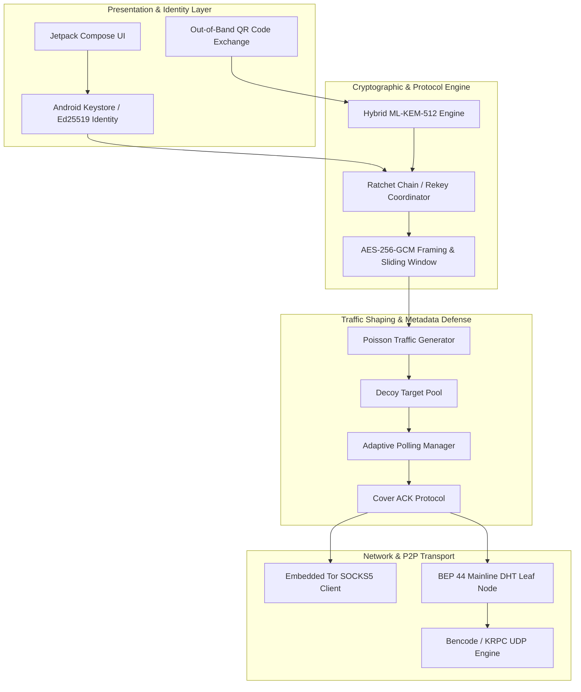
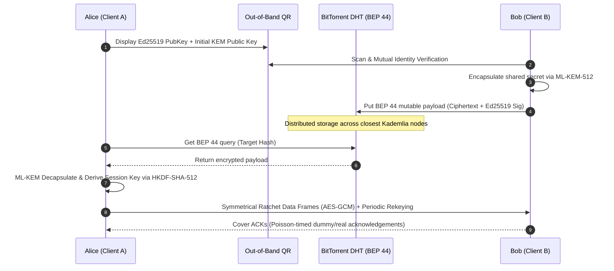

# PQChat.DHT

<p align="center">
  <strong>Decentralized, Post-Quantum P2P Covert Messaging over BitTorrent Mainline DHT</strong><br>
  <em>Statistical Traffic Masking • Formal ProVerif Verification • Zero Infrastructure</em>
</p>

<p align="center">
  <a href="https://github.com/mppjuro/PQChat.DHT/actions/workflows/android.yml">
    
  </a>
  <a href="https://github.com/mppjuro/PQChat.DHT/actions/workflows/nightly.yml">
    
  </a>
  <a href="LICENSE">
    
  </a>
  <a href="https://csrc.nist.gov/pubs/fips/203/final">
    
  </a>
  <a href="docs/formal/">
    
  </a>
  <a href="https://github.com/mppjuro/PQChat.DHT/actions/workflows/formal_verification.yml">
    
  </a>
  <a href="CHANGELOG.md">
    
  </a>
  <a href="https://github.com/mppjuro/PQChat.DHT/releases/tag/nightly">
    
  </a>
</p>

---

## 🔬 Overview & Academic Context

Traditional secure messaging platforms rely on centralized directory and signaling servers, leaking rich transactional metadata (timing, communication graphs, peer IP addresses) and remaining susceptible to future decryption by quantum adversaries through **Harvest Now, Decrypt Later (HNDL)** attacks.

**PQChat.DHT** is an experimental, serverless peer-to-peer covert messaging system developed for Android as part of a Master's Thesis in Computer Science. It achieves end-to-end privacy and metadata resistance by combining:
1. **Post-Quantum Cryptography (PQC)**: Key exchange based on **ML-KEM-512** (NIST FIPS 203) with double ratcheting for Forward Secrecy and Post-Compromise Security.
2. **Serverless P2P Storage**: Storage and discovery via BitTorrent Mainline DHT using signed mutable items (**BEP 44** / Kademlia).
3. **Statistical Traffic Masking**: Shaping network traffic using Poisson-distributed cover traffic, blind republishing, and decoy queries to defeat side-channel and timing correlation attacks.
4. **Network Obfuscation**: Optional embedded SOCKS5 routing through the Tor network.
5. **Formal Verification**: Verified protocol invariants using **ProVerif 2.05+** symbolic analysis.

> [!WARNING]
> **Alpha Status**: This project is an academic research prototype. While the core protocol has been formally verified with ProVerif, the Android implementation has not undergone independent professional cryptographic and application security audits. Do not rely on it for operational life-critical communications.

---

## 🏛️ System Architecture



---

## ✨ Key Features

### 1. Post-Quantum End-to-End Cryptography

* **ML-KEM-512 (FIPS 203 / Kyber)**: High-performance lattice-based key encapsulation mechanism protecting against both classical and quantum adversaries (`MLKemEngine.kt`).
* **Hardware-Backed Identity**: Ed25519 signing keys anchored in the Android hardware-backed Keystore (`KeystoreCrypto.kt`, `Ed25519Engine.kt`).
* **Ratchet Rekeying Engine**: Ephemeral ratchet chains providing both **Perfect Forward Secrecy (PFS)** and **Post-Compromise Security (PCS)** (`RatchetChain.kt`, `RekeyCoordinator.kt`).
* **Frame Integrity**: Authenticated framing via AES-256-GCM with replay protection through bitmap sliding windows (`SlidingWindowBitmap.kt`, `BinaryFrameCodec.kt`).

### 2. Decentralized BEP 44 DHT Transport

* **Zero Infrastructure**: Operates on the public BitTorrent Mainline DHT network with no custom servers, relays, or STUN/TURN infrastructure.
* **Lightweight Leaf Node**: Memory- and battery-conscious Android Kademlia leaf node (`DhtLeafNode.kt`, `DhtClient.kt`).
* **Performance Enhancements**: Implements **Target Pre-Warming** and **Fast Termination** algorithms to minimize DHT lookup latency under flaky mobile networks (`FastTerminationTest.kt`, `TargetPreWarmingTest.kt`).
* **BEP 44 Encrypted Storage**: Stores cryptographically signed, encrypted blobs indexed by target hashes.

### 3. Traffic Analysis Countermeasures

* **Poisson-Distributed Intervals**: Masking bursty human chat habits with randomized packet emission following a Poisson point process (`PoissonTrafficGenerator.kt`).
* **Decoy Target Pooling & Blind Republishing**: Injects indistinguishable decoy DHT queries and background republish packets into the peer network (`DecoyTargetPool.kt`, `BlindRepublishPool.kt`).
* **Cover ACKs**: Prevents correlation between message delivery and acknowledgement frames (`CoverAckProtocol.kt`).
* **Adaptive Polling**: Dynamically schedules background poll workers without waking the radio unnecessarily (`AdaptivePollingManager.kt`, `PollingScheduler.kt`).

### 4. Anonymity & Media Processing

* **Embedded Tor Support**: Embedded Tor daemon runner for SOCKS5 proxy routing (`EmbeddedTorManager.kt`, `TorSocketFactory.kt`).
* **Low-Bandwidth Media Compression**: In-flight 8-bit PNG palette quantizer (`Png8Compressor.kt`) and chunked frame stream delivery (`ChunkingEngine.kt`) designed to fit small payload constraints.
* **Out-of-Band Pairing**: Mutual contact pairing via animated QR codes (`CameraQrScanner.kt`, `QrCodeUtil.kt`).

### 5. Decentralized Post-Quantum Group Messaging (Sender Keys over BEP 44)

* **Metadata-Free Group Addressing (`deriveGroupRecipientSlot`)**: Eliminates Group Follower Correlation in DHT lookups. For each broadcast, sender derives distinct pseudorandom destination addresses for each recipient:
  $`\text{Target}_{slot} = \text{RatchetChain.deriveGroupRecipientSlot}(ChainKey, Counter, GroupID, RecipientMemberID)`$
  No two members ever poll the same DHT slot, completely preventing observers from correlating group members or estimating group size.
* **Outbound Sender Chains**: Each member maintains an independent 64-byte sender chain key ($`myChainKeyOut`$) distributed via Type `0x06` (`TYPE_GROUP_CONTROL`) frames over authenticated 1-on-1 channels protected by hybrid ML-KEM-512 + X25519.
* **Cryptographic Context Binding (AAD)**: Payloads are encrypted with AES-256-GCM bound to $`\text{AAD} = \text{Target} \parallel GroupID \parallel SenderMemberID`$, preventing cross-group replay or sender impersonation.
* **Group Forward Secrecy & Post-Compromise Security (PCS)**: Automatic epoch rotation every 50 messages, and mandatory instant rotation upon member departure (`GROUP_SUBTYPE_LEAVE`), distributing new keys to active members only and guaranteeing Post-Leave Secrecy.

---

## 🔒 Protocol Flow



Detailed message layouts, frame headers, and serialization rules are specified in [`docs/PROTOCOL.md`](docs/PROTOCOL.md). The security assumptions and adversary capabilities are analyzed in [`docs/threat_model.md`](docs/threat_model.md).

---

## 📐 Formal Verification (ProVerif)

The core cryptographic protocol is formally verified using **[ProVerif](https://bblanche.gitlabpages.inria.fr/proverif/)** symbolic protocol analyzer. All verification scripts and proof models are unified in the [`docs/formal/`](docs/formal/) directory.

The formal suite encompasses dual-defense **Hybrid KEM (ML-KEM-512 + X25519)**, **Anti-Grinding SAS**, **Dual Unidirectional Chains**, **900-byte CSPRNG safe tombstones**, and **Decentralized Post-Quantum Group Messaging** (24 lemmas verified across 7 models):

| Property | Model File | Verified Security Guarantee | Status |
| --- | --- | --- | --- |
| **Unified Protocol** | `pqchat_protocol.pv` | MasterKey, dual chain keys, AAD-bound payloads, SAS binding & replay | `RESULT: True` (8/8) |
| **Secrecy & Confirmation** | `pqchat_secrecy.pv` | Payload secrecy & injective mutual authentication under Hybrid KEM | `RESULT: True` (5/5) |
| **Forward Secrecy** | `pqchat_forward_secrecy.pv` | Past messages protected upon ratchet state compromise in RAM | `RESULT: True` (2/2) |
| **Post-Compromise (PCS)** | `pqchat_post_compromise.pv` | Session recovery & self-healing after breach via Hybrid KEM rekey | `RESULT: True` (2/2) |
| **Replay Protection** | `pqchat_replay.pv` | Injective packet correspondences & safe tombstone slot invalidation | `RESULT: True` (2/2) |
| **Unlinkability & Tombstones** | `pqchat_unlinkability.pv` | Target unlinkability (diff-equivalence) & 900B tombstone indistinguishability | `RESULT: True` (1/1) |
| **Group Protocol & PCS/FS** | `pqchat_group_protocol.pv` | Group sender keys distribution, AAD binding, and group PCS/FS on member leave | `RESULT: True` (4/4) |

To reproduce the formal verification suite locally:

```bash
bash docs/formal/run_verification.sh
```

---

## 🧪 Testing & Fuzzing

The repository maintains an extensive test suite exceeding standard unit testing:

* **Known Answer Tests (KAT)**: Validates ML-KEM-512 against official NIST test vectors (`MlKemKatAndUniquenessTest.kt`).
* **Security & Parser Fuzzing**: Continuous fuzzing powered by **Jazzer** targeting KRPC message parsing and Bencode decoders (`JazzerFuzzTest.kt`, `BencodeSecurityTest.kt`).
* **Traffic Threat Statistical Tests**: Monte-Carlo simulations testing statistical indistinguishability of cover traffic (`TrafficThreatModelStatisticalTest.kt`).
* **DHT Integration Tests**: Real-world loopback and remote DHT persistence verification (`RealBep44RemoteIntegrationTest.kt`, `tools/dht_harness/`).

Run unit and integration tests:

```bash
./gradlew testDebugUnitTest

```

---

## 📊 Empirical Benchmarks & Simulation

The repo includes reproducible Python test harnesses and threat simulators to evaluate battery, bandwidth, and latency trade-offs:

* **Loopback DHT Measurement**: Real packet retention and latency charts generated under [`docs/dht_retention_report.md`](docs/dht_retention_report.md).
* **Threat Simulator**: Simulates deanonymization probability against adversary nodes under varying cover-traffic rates (`tools/threat_sim/threat_simulator.py`).

```bash
# Run the simulation suite
cd tools/threat_sim
pip install -r requirements.txt
python threat_simulator.py

```

---

## 📂 Repository Layout

```text
PQChat.DHT/
├── .github/                 # Workflows: CI, Dependabot, Nightly & Remote DHT tests
├── app/
│   └── src/
│       ├── main/java/org/pqchat/dht/
│       │   ├── crypto/      # ML-KEM, Ed25519, AES-GCM, HKDF, Keystore wrappers
│       │   ├── data/        # Room Database, Repositories, Preferences
│       │   ├── dht/         # BEP 44 client, Kademlia leaf node, KRPC, Bencode
│       │   ├── media/       # PNG-8 quantizer & compressor
│       │   ├── network/tor/ # Embedded Tor daemon & SOCKS5 socket factory
│       │   ├── protocol/    # Handshake, Ratchet chains, Chunking, Cover ACKs
│       │   ├── service/     # Foreground polling, Alarm receivers, WorkManager
│       │   ├── traffic/     # Poisson generator, Decoy pools, Blind republishing
│       │   └── ui/          # Jetpack Compose screens, ViewModels, QR scanner
│       └── test/java/       # KAT tests, Jazzer fuzzing, Concurrency & Property tests
├── docs/                    # Technical documentation, PROTOCOL.md, Threat Model
│   └── formal/              # ProVerif formal verification models (.pv) & scripts
└── tools/
    ├── dht_harness/         # P2P loopback benchmarking scripts & raw CSV metrics
    └── threat_sim/          # Python Monte-Carlo anonymity vs. battery simulator

```

---

## 🚀 Building & Getting Started

### Prerequisites

* **JDK 17** or **JDK 21**
* **Android SDK** (minSdk 26, targetSdk 34)
* **Android Studio Ladybug** (2024.2+) or CLI Gradle

### Build Instructions

```bash
# Clone the repository
git clone https://github.com/mppjuro/PQChat.DHT.git
cd PQChat.DHT

# Verify code style and linting
./gradlew lintDebug

# Run unit tests and crypto KATs
./gradlew testDebugUnitTest

# Build the debug APK
./gradlew assembleDebug

```

The compiled APK will be available in `app/build/outputs/apk/debug/app-debug.apk`.

---

## 📜 Changelog & Releases

- **Historia zmian:** Pełna lista wprowadzonych funkcji, poprawek i zmian znajduje się w pliku [`CHANGELOG.md`](CHANGELOG.md).
- **Oficjalne wydania (Releases):** Przejdź do zakładki [Releases](https://github.com/mppjuro/PQChat.DHT/releases), aby pobrać stabilne pakiety instalacyjne APK.
- **Wydania codzienne (Nightly Builds):** Najnowsza wersja deweloperska APK jest automatycznie kompilowana co noc i dostępna w [Nightly Release](https://github.com/mppjuro/PQChat.DHT/releases/tag/nightly).

---

## 📄 License & Attribution

This project is licensed under the **GNU General Public License v3.0** (GPLv3) — see the [`LICENSE`](LICENSE) file for details.

### Academic Citation

If you utilize this work or its formal models in academic research, please cite:

```bibtex
@mastersthesis{pqchat_dht_2026,
  author       = {Miłosz Piórkowski},
  title        = {Zdecentralizowany komunikator mobilny P2P odporny na analizę ruchu, oparty na sieci DHT i kryptografii postkwantowej},
  school       = {Nicolaus Copernicus University in Toruń (UMK)},
  year         = {2026},
  note         = {GitHub: [https://github.com/mppjuro/PQChat.DHT](https://github.com/mppjuro/PQChat.DHT)}
}

```
